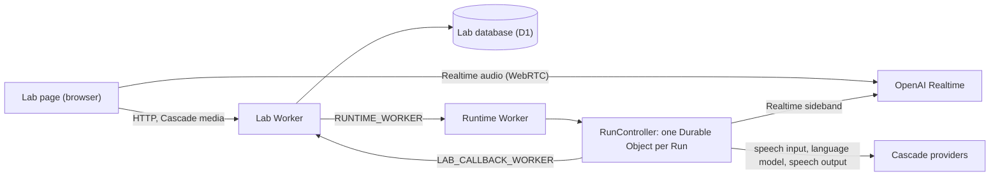

# Architecture

voiceflare carries out each interview as a Run: one participant, one Conversation on one
execution, from its start to a delivered result. This page names the parts and how they connect.
[Adding a combination](adding-a-combination.md) names the files to change.

## Two Workers and a page

| Part           | Where                                                            | What it does                                                                                                                  |
| -------------- | ---------------------------------------------------------------- | ----------------------------------------------------------------------------------------------------------------------------- |
| Lab page       | `src/apps/lab/`, built by Vite into `dist/lab/client/`           | The editors, the execution panels, the live interview and the transcript review. React.                                       |
| Lab Worker     | `worker/lab.ts`, `worker/lab/`, `wrangler.lab.jsonc`             | Serves the page and its API, keeps Runs, prompts and diagnostics in the Lab database, starts Runs and receives their results. |
| Runtime Worker | `worker/runtime.ts`, `worker/runtime/`, `wrangler.runtime.jsonc` | The voice engine. Each Run lives in its own Durable Object, `RunController`. Runtime alone holds the provider keys.           |
| Lab database   | `worker/migrations/0001_lab.sql`                                 | A D1 database, local to `wrangler dev`.                                                                                       |

The Workers call each other over private service bindings, never over public URLs. The Lab calls
Runtime on `RUNTIME_WORKER`. Runtime delivers to the Lab on `LAB_CALLBACK_WORKER`, which reaches
the Lab Worker's `LabRuntimeCallbacks` entrypoint. `pnpm dev` runs both Workers in one
`wrangler dev`. They keep the names they have in EventPulse: `eventpulse-runtime` and
`eventpulse-lab`.

Runtime and the execution kits are written with [Effect](https://effect.website).

## Four responsibilities

An interview needs four responsibilities. Three are inside the engine; the fourth is the
application that uses it.

| Responsibility          | Holds                                                                                                                                       | In voiceflare                              |
| ----------------------- | ------------------------------------------------------------------------------------------------------------------------------------------- | ------------------------------------------ |
| Media and turn pipeline | Audio transport, speech recognition and synthesis, turn detection, interruption, audio queues, provider connections and their cleanup.      | The execution kits, `worker/providers/`    |
| Interview coordinator   | What the interview does while it is live: the current question, the instructions and tools the model receives, when to move on or close.    | The Conversations, `worker/conversations/` |
| Completion kernel       | How a Run ends and what it reports: the accepted end reason, the final input and output, deadlines, provider closure, the result, delivery. | Runtime, `worker/runtime/`                 |
| Application             | The interview's input, what the participant sees, and receiving and storing the transcript and result.                                      | The Lab                                    |

The first three run in the same Durable Object, but each keeps its own rules:

- an execution reports what happened, such as a finished utterance or a delivered reply, and never
  decides that the interview ends;
- a Conversation asks for its next state or for the end, and never changes how Runtime ends a Run;
- Runtime asks an execution for operations, such as entering a state, and never calls a provider
  itself;
- a provider's message shapes are translated inside its kit and go no further.

`pnpm architecture:check` enforces the boundaries between them ([below](#checks-that-keep-the-structure)).

## Conversations

A Conversation is an interview design that does not depend on a provider. Each is one pure module in
`worker/conversations/`, which states:

- its input: a strict schema whose format name, such as `goodbye-interview-input/v1`, is versioned;
- its states, and what the model receives in each: instructions, operational instructions and
  tools;
- what each tool call means;
- how it progresses: the opening state, the timers of each state and the transitions;
- for a Conversation that ends with a Goodbye, how its closing is assessed.

| Conversation       | Module                  | States                                                                                                                                  |
| ------------------ | ----------------------- | --------------------------------------------------------------------------------------------------------------------------------------- |
| Original interview | `originalInterview.ts`  | `interviewing`, then `finishing`: the model says its closing message and calls `finish_interview` in the same reply.                    |
| Dedicated Goodbye  | `goodbyeInterview.ts`   | `interviewing`, then `goodbye`: the model calls `finish_interview` without speaking, and the closing sentence from the input is spoken. |
| Questions          | `questionsInterview.ts` | `question`, entered once per question and advanced by `next_question`, then `goodbye`.                                                  |

A Conversation holds no wording of its own. Its instructions, tool descriptions and closing
sentence come from its input, which the Lab builds from the texts in `src/apps/lab/content/`.

## Executions

An execution carries out a Conversation on providers. Each is a kit in `worker/providers/` with the
same three operations:

- a conversing phase, where the interviewer and the participant take turns;
- a closing, which says a given sentence;
- finishing, the default, where the reply in progress plays to its end.

Each kit also declares its settings, the keys its providers need, the usage they report and the
warnings it may attach to a result.

### Realtime

`worker/providers/openaiRealtime/` uses OpenAI Realtime, one speech-to-speech model. The page sends
its WebRTC offer through the Lab to Runtime, which creates the call at OpenAI. Audio then flows
directly between the browser and OpenAI, and OpenAI detects the turns. Runtime joins the same call
over a sideband WebSocket: it sends each state's instructions and tools, and reads the transcript,
the tool calls and the usage.

### Cascade

`worker/providers/cascade/` chains three components, each with providers to choose from:

| Component                      | Default  | Also available         |
| ------------------------------ | -------- | ---------------------- |
| Speech input (speech-to-text)  | Soniox   | Gradium                |
| Language model                 | Cerebras | OpenAI (Responses API) |
| Speech output (text-to-speech) | Soniox   | Gradium                |

The page streams microphone audio to Runtime over a WebSocket through the Lab, and plays the speech
Runtime sends back. Turns alternate: the microphone opens once the interviewer's reply has played,
and closes when the participant's turn ends.

A Run chooses its provider for each component, and that provider's settings, in the Lab's Cascade
panel. Each provider module declares, next to its adapter, its settings and their defaults, its
key and the usage it reports; `settings.ts` lists the providers of each component. Swapping a
provider is a setting. Adding one is a new provider module.

The kit's stand-ins, in `testing/standIns.ts`, replace the three providers in Runtime's Cascade
tests. Their speech input understands only recorded answers.

## The registry

`worker/runtimeHostComposition.ts` pairs Conversations with executions. It has three tables:
`conversations`, `executions` and `registry`, with one row per combination. Each row names a
Conversation, an execution and the pair that implements the one on the other. A pair is a folder in
`worker/implementations/`, such as `goodbyeCascade/`: the Conversation's handlers for that
execution, and its configuration of the kit's session.

Runtime's catalog, `GET /_runtime/conversation-selections`, lists every row. Each entry has an id,
such as `goodbye-interview-cascade`, a name, such as "Dedicated Goodbye · Cascade", an input format
and an availability. A combination is available when Runtime has the keys its providers need;
otherwise its availability names the missing keys, and the Lab disables it. Runtime starts only the
combinations the registry lists, with an input their Conversation's schema accepts.

## A Run, from its start to a delivered result

1. **Start.** The Lab records a new Run in its database and asks Runtime to start it. The request
   names the combination, the Conversation's input, the execution's settings and where to deliver:
   the Lab, and the Run's ID. Runtime checks the input against the Conversation's schema and the
   keys against the providers', and refuses a Start it cannot carry out, for example with
   `missing_credentials:<names>`. Before it accepts the Run, it asks the Lab whether it holds that
   Run.
2. **Startup.** The page connects its media, and Runtime and the page confirm they are ready. A Run
   that cannot start before its deadline ends as `failed_to_start`.
3. **Live.** The Conversation's states advance on the model's tool calls and on timers. Runtime
   enters each state on the execution with what the Conversation prepares for it, and records the
   transcript as it goes.
4. **Ending.** The first accepted end reason wins: the participant stopped, the time limit was
   reached, or the interviewer asked to end. A provider or Runtime failure ends the Run as
   `interrupted`. On a normal end, Runtime waits until the last reply has had time to play, plus a
   two-second margin. Ending then takes at most ten seconds: Runtime closes input, waits for the
   participant's final words to be transcribed, and closes the provider call.
5. **Result.** Runtime freezes the result once. It holds the outcome (`completed` with its reason,
   `interrupted` or `failed_to_start`), the transcript's identity and whether the transcript is
   complete, the usage the providers reported and whether it is complete, and any warnings.
6. **Delivery.** Runtime delivers the transcript and the result to the Lab, and retries each until
   the Lab acknowledges it.

### The callbacks

Every application that Runtime delivers to implements the same callbacks, `ApplicationCallbacks`
in `worker/runtime/applicationCallbacks.ts`, on a private service binding. Runtime's configuration
binds each application as `<APPLICATION>_CALLBACK_WORKER`, and voiceflare binds the Lab.

| Callback            | Carries                                                          |
| ------------------- | ---------------------------------------------------------------- |
| `authorizeDelivery` | The question asked before acceptance: does the Lab hold the Run? |
| `readiness`         | The readiness exchange of startup.                               |
| `transcript`        | Each revision of the transcript, live or frozen.                 |
| `completion`        | Every result, a failed start's included.                         |
| `startupDiagnostic` | Runtime's startup timings, best effort. The Lab keeps none.      |

The Lab stores what it receives in its database (`worker/lab/persistence/`) and refuses a callback
for a Run it does not hold.

## The guarantee

Every interview ends with one truthful outcome and a delivered result.

- **One outcome.** A Run accepts one end reason, the first, and freezes one result, which nothing
  changes afterwards. The Run's state is stored in its Durable Object, so a restarted object
  rebuilds the Run from storage and delivers the result it froze.
- **Truthful.** The result says what is missing instead of hiding it. A transcript that lacks an
  item is marked incomplete, with its reasons, and usage a provider did not report is marked
  incomplete. A failure is reported as `interrupted` or `failed_to_start`, never as a completion.
- **Delivered.** Runtime sends the result from a durable outbox in the Run's Durable Object and
  retries until the Lab acknowledges it. A retry carries the same result: the Lab acknowledges an
  identical repeat and refuses a different result for the same Run. Automatic delivery stops 30
  seconds after the result froze, and Runtime then records `runtime.publication_expired`.
- **A Run that never started.** When a Run's startup passes its deadline, the Lab marks it failed
  and asks Runtime to stop it, retrying until Runtime answers. If Runtime never accepted the Run, it
  has no result to deliver, so the Lab records the `failed_to_start` result itself.

## Checks that keep the structure

| Check                                             | Enforces                                                                                                                                                                                                      |
| ------------------------------------------------- | ------------------------------------------------------------------------------------------------------------------------------------------------------------------------------------------------------------- |
| `scripts/check-conversation-boundaries.ts`        | Conversations are pure. Every pair folder holds its `implementation.ts`. Pairs do not import one another; kits import no pair or Conversation.                                                                |
| `scripts/check-boundary-contract-declarations.ts` | Outside input is parsed by `boundary(...)` declarations from `tools/boundary-contracts/`, which return a parsed value.                                                                                        |
| `tooling/check-typescript-foundation.ts`          | Maintained source is TypeScript. The type policy forbids explicit `any`, non-null assertions, definite-assignment assertions and double assertions.                                                           |
| `scripts/check-effect-diagnostics.ts`             | Every Worker file that imports Effect is listed in `tsconfig.effect.json` and passes Effect's diagnostics. Runtime and kit code follow the clock rule and reach promises only in the places the script lists. |

`pnpm architecture:check` runs the first three, `pnpm effect:check` the last, and `pnpm check`
runs them all with the tests.
